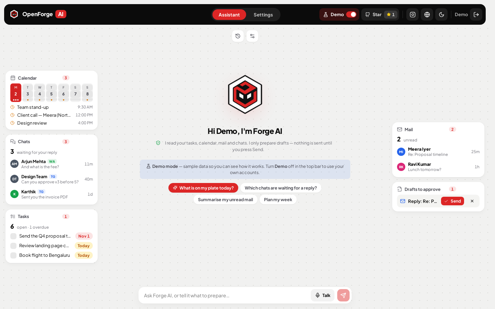
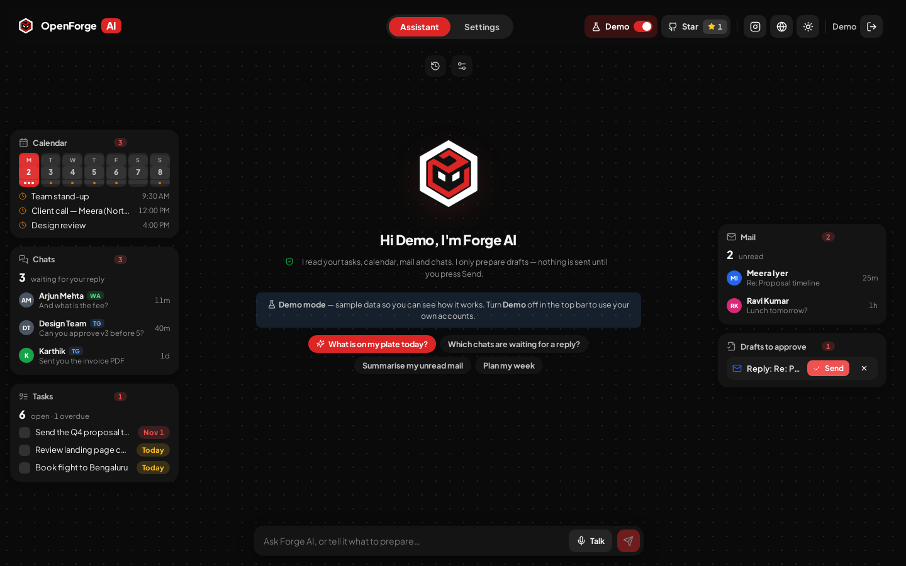
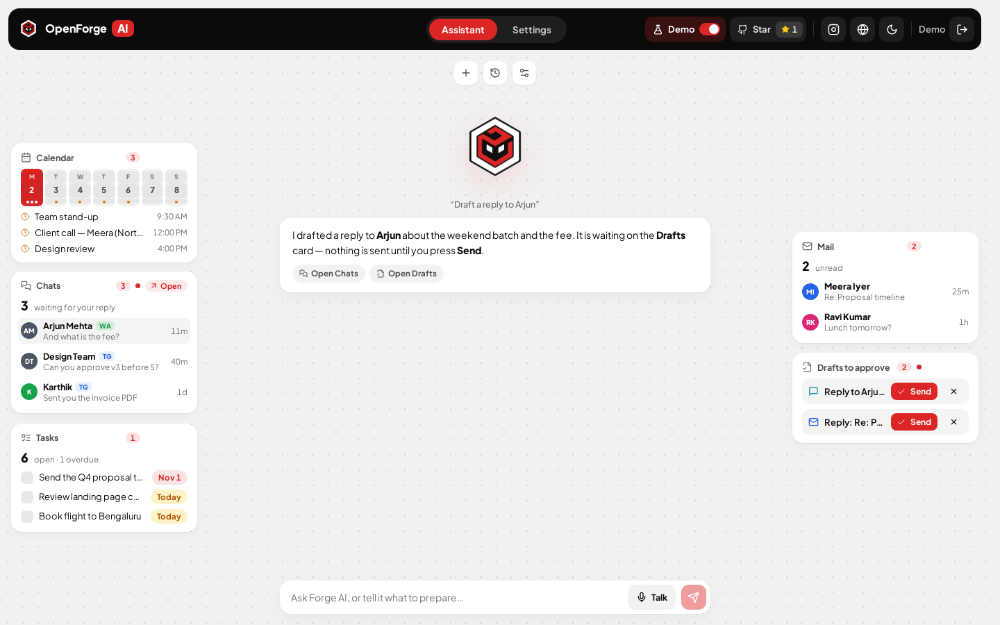
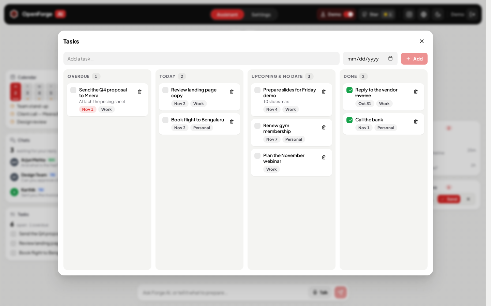
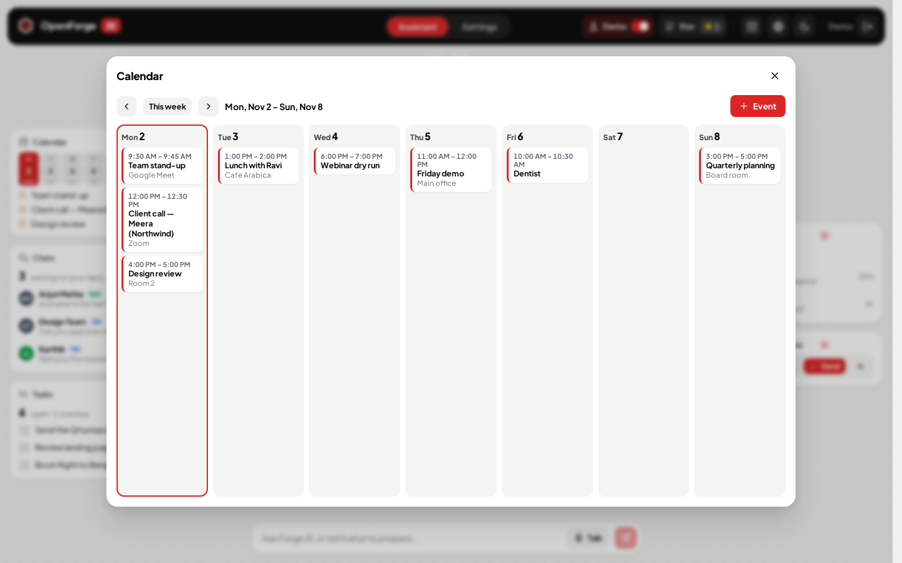
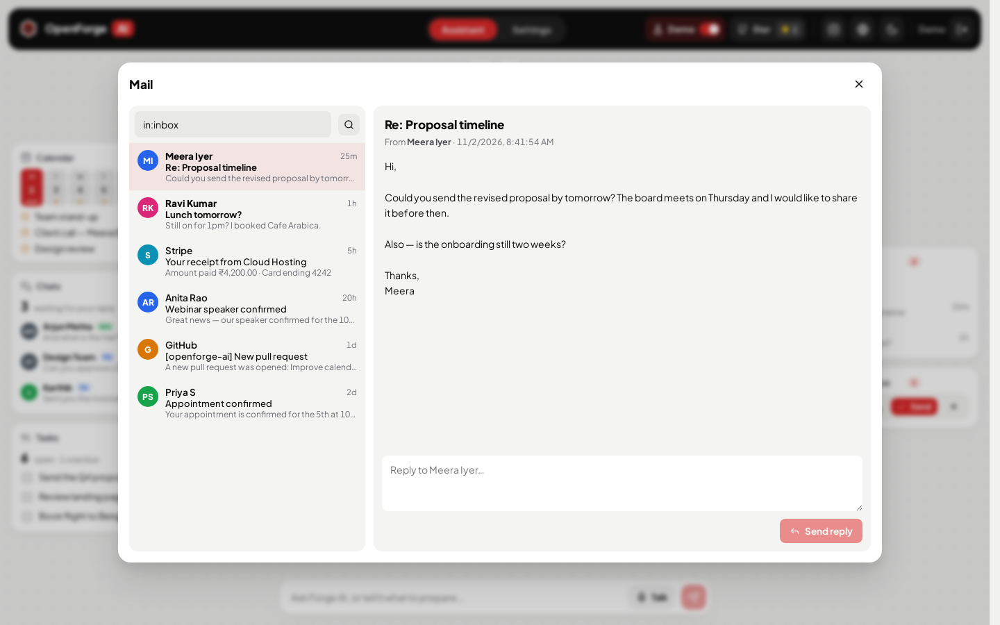
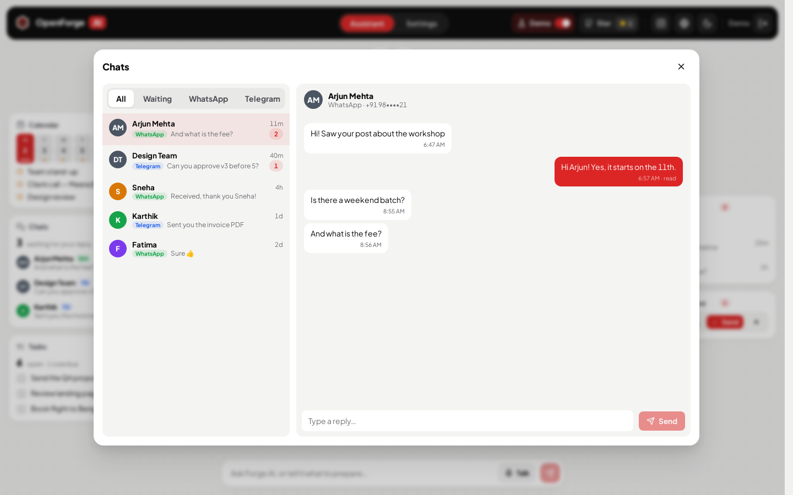
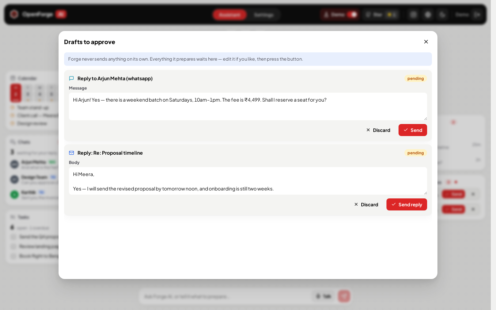
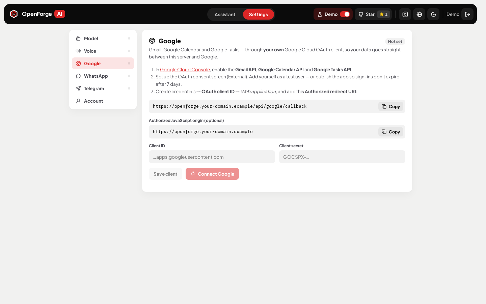

# OpenForge AI

<p align="center"></p>

A self-hosted, open-source AI assistant for your **tasks, calendar, mail and chats** — in one office-style screen. Built by [Forgemind AI](https://forgemind.in/) · [@forgemind_ai](https://www.instagram.com/forgemind_ai/) on Instagram.



OpenForge AI puts your Google Tasks, Google Calendar, Gmail and a unified WhatsApp + Telegram inbox around an assistant called **Forge**. Ask it anything ("what's on my plate today?", "which chats are waiting on me?", "draft a reply to Arjun") by typing, or press **Talk** and speak to it in real time.

**Forge never sends anything on its own.** When it wants to send a message, an email, add an event or create a task, it prepares a **draft** on the *Drafts to approve* card. Nothing leaves until you press **Send / Confirm** (you can edit the draft first).

It ships with **zero credentials**. Every person on an install brings their own keys:

| What | Used for | Where you get it |
|---|---|---|
| OpenAI **or** Anthropic API key | the chat model + tool calling | platform.openai.com · console.anthropic.com |
| Gemini API key | **Talk** — real-time voice (Gemini Live) | aistudio.google.com/apikey |
| Google OAuth Client ID + Secret | Gmail, Google Calendar, Google Tasks | Google Cloud Console |
| WhatsApp Cloud API phone number ID + token | WhatsApp chats | developers.facebook.com |
| Telegram bot token | Telegram chats | @BotFather |

Keys are entered on the **Settings** page and stored **encrypted** (AES-256-GCM) in the server's database. They are never sent back to the browser.

## Demo mode

Switch **Demo** on in the top bar to see every card filled with sample tasks, events, emails and chats, and to try the assistant with scripted answers — before you connect anything. A new user starts in demo mode until they connect something; the switch is remembered per browser. Demo data lives only in the browser tab and never touches your accounts.

## Screenshots

| | |
|---|---|
|  |  |
| **Dark theme** | **Forge prepares a draft — you press Send** |
|  |  |
| **Tasks** — kanban over Google Tasks | **Calendar** — week view |
|  |  |
| **Mail** — Gmail inbox, reader and reply | **Chats** — WhatsApp + Telegram in one inbox |
|  |  |
| **Drafts to approve** | **Settings** — your own keys, step by step |

---|---|---|
| OpenAI **or** Anthropic API key | the chat model + tool calling | platform.openai.com · console.anthropic.com |
| Gemini API key | **Talk** — real-time voice (Gemini Live) | aistudio.google.com/apikey |
| Google OAuth Client ID + Secret | Gmail, Google Calendar, Google Tasks | Google Cloud Console |
| WhatsApp Cloud API phone number ID + token | WhatsApp chats | developers.facebook.com |
| Telegram bot token | Telegram chats | @BotFather |

Keys are entered on the **Settings** page and stored **encrypted** (AES-256-GCM) in the server's database. They are never sent back to the browser.

---

## Features

- **Office view** — the same layout as the Forge AI assistant in Forge Growth: slim rails of cards (Calendar, Chats, Tasks · Mail, Drafts) that open full size on click, the animated Forge in the middle with its latest answer, a floating composer at the bottom. Light and dark themes.
- **Conversations** — every typed and spoken conversation is saved; reopen and continue any of them from the history button.
- **Demo mode** — sample data in every card so you can see it working before connecting anything.
- **Chat with tools** — Forge reads your real data through tools (overview of the day, tasks, events, mail search/read, chats) and opens the relevant card on screen.
- **Talk** — live, interruptible voice with Gemini Live, using the same tools. Transcripts are saved to your conversation history.
- **Tasks** — a kanban (Overdue / Today / Upcoming / Done) over all your Google Tasks lists. Drag to re-date, tick to complete, add new.
- **Calendar** — a week view of your primary Google Calendar; add events.
- **Mail** — Gmail inbox with search, a reader and reply.
- **Chats** — one inbox for WhatsApp (Cloud API webhook) and Telegram (bot webhook). Reply from the app. Respects WhatsApp's 24-hour reply window.
- **Drafts to approve** — everything the assistant prepares waits here for your button press.
- **Multi-user** — the first visitor creates the admin account (no default password); the admin adds more people. Everyone's keys and data are separate.
- Phone numbers are masked in the assistant's view and answers.

## Quick start

You need **Docker** (with Compose v2). Everything else runs in one container.

```bash
git clone https://github.com/Forgemind-git/openforge-ai.git
cd openforge-ai
cp .env.example .env          # set PUBLIC_URL to the address you will open
docker compose up -d --build
```

Open `http://localhost:3000` (or your `PUBLIC_URL`), **create the admin account**, then add your keys in **Settings**. Until you connect something, the app opens in **demo mode** so you can look around.

> **HTTPS is required for the real integrations.** WhatsApp and Telegram can only deliver webhooks to a public HTTPS address, Google sign-in needs a registered redirect URL, and browsers only allow the microphone (Talk) on HTTPS. Use `localhost` for a look around; put it behind a TLS proxy for real use.

**→ Full deployment guide: [docs/DEPLOY.md](docs/DEPLOY.md)** — a VPS from scratch, Traefik / Caddy / nginx, running without Docker, upgrades, backups, monitoring and troubleshooting.

### Configuration (`.env`)

| Variable | Default | Meaning |
|---|---|---|
| `PUBLIC_URL` | derived from the request | Public origin, no trailing slash. Builds the Google redirect URI and the webhook URLs. **Set it** in production. |
| `OPENFORGE_PORT` | `3000` | Host port published by `docker-compose.yml`. |
| `SESSION_SECRET` | generated | Signs login cookies. Blank = random, stored in the data volume. |
| `ENCRYPTION_KEY` | generated | Encrypts every saved key (AES-256-GCM). Blank = random, stored in the data volume. **Changing it later makes saved keys unreadable.** |
| `OPENFORGE_GITHUB_REPO` | `Forgemind-git/openforge-ai` | Repo for the GitHub star button in the top bar; `none` hides it. The star count is checked hourly and stored in the database. |
| `DEMO_LOGIN_EMAIL`, `DEMO_LOGIN_PASSWORD` | off | For a public demo only: seeds that account at boot and **shows** its email and password on the sign-in page. Leave blank for real use. |
| `OPENFORGE_HOST`, `TRAEFIK_NETWORK`, `TRAEFIK_CERTRESOLVER` | — | Only for `docker-compose.traefik.yml`. |

All data — the SQLite database and the generated secrets — lives in the `openforge-data` volume at `/data`. **Back it up** (see the deploy guide).

## Setting up each integration

### 1. Model — OpenAI or Anthropic
Settings → **Model**: pick the provider, paste your API key, choose a model (the list is fetched from the provider with your key). Saving tests the key.

### 2. Voice — Gemini Live
Settings → **Voice**: paste a Gemini API key from [Google AI Studio](https://aistudio.google.com/apikey). Pick a voice and the Live model (default `gemini-3.1-flash-live-preview`; any Gemini model that supports the Live API works). Press **Talk** on the main screen — the browser asks for the microphone (needs HTTPS).

### 3. Google — Gmail, Calendar, Tasks
Each user uses **their own** Google Cloud OAuth client:

1. Open [Google Cloud Console](https://console.cloud.google.com/), create (or pick) a project.
2. **APIs & Services → Library** — enable **Gmail API**, **Google Calendar API** and **Google Tasks API**.
3. **OAuth consent screen** — choose *External*, fill in the app name and your email. Add the scopes when asked (or let the sign-in request them): `gmail.readonly`, `gmail.send`, `calendar.events`, `tasks`, plus `openid`/`email`/`profile`.
   - While the app is in **Testing**, add yourself under *Test users*. Note Google expires refresh tokens of Testing-mode apps after **7 days** — publish the app (or press *Reconnect* weekly).
4. **Credentials → Create credentials → OAuth client ID → Web application**.
   - **Authorized redirect URI:** copy it from Settings → Google. It is `PUBLIC_URL/api/google/callback`, e.g. `https://openforge.example.com/api/google/callback`.
5. Copy the **Client ID** and **Client secret** into Settings → Google, press **Save client**, then **Connect Google** and approve every permission.

### 4. WhatsApp — Cloud API
1. At [developers.facebook.com](https://developers.facebook.com/apps) create a *Business* app and add **WhatsApp**.
2. WhatsApp → **API Setup**: copy the **Phone number ID**. The temporary token there lasts 24 hours — for a permanent one create a **System User** in Meta Business Settings, give it the app and the WhatsApp account, and generate a token with `whatsapp_business_messaging` (and `whatsapp_business_management`).
3. Settings → **WhatsApp**: paste the phone number ID and token; optionally a verify token of your choice and the app secret (App settings → Basic) so every webhook's signature is checked. Press **Save & test**.
4. Copy the **Callback URL** and **Verify token** shown, paste them into WhatsApp → **Configuration → Webhook**, press *Verify and save*, then **subscribe to `messages`**.

Messages people send to your number now appear in **Chats**. WhatsApp only allows a free-text reply within **24 hours** of the person's last message; outside that window Meta requires an approved template (not covered by OpenForge AI).

### 5. Telegram — bot
1. Message [@BotFather](https://t.me/BotFather), send `/newbot`, copy the token.
2. Settings → **Telegram**: paste it and press **Save & register webhook**. OpenForge AI calls `setWebhook` for you (with a secret token so only Telegram can post to it).
3. For group chats, disable privacy mode with `/setprivacy` in BotFather.

## How the "never sends on its own" rule is enforced
The assistant's tool list (`server/src/assistant/tools.js`) contains only **read** tools and `prepare_*` tools. A `prepare_*` tool only inserts a row into the `actions` table. The code that actually sends (`server/src/assistant/actions.js`) is reachable only from `POST /api/actions/:id/confirm` — the button on the Drafts card — and claims the draft atomically so a double click cannot send twice. `server/test/tools.test.js` fails if a tool that acts directly is added.

## How it works

```
Browser (React)  ──HTTPS──>  OpenForge AI server (Node/Express, one container)
   │  cards, chat, settings         │  SQLite in /data (users, encrypted keys, chats, drafts, conversations)
   │                                ├── OpenAI / Anthropic  (chat + tool calling, your key)
   └── Talk: WebSocket ───────────> ├── Gemini Live          (voice, your key — the server proxies it)
                                    ├── Google APIs           (Gmail, Calendar, Tasks — your OAuth client)
   Meta / Telegram ──webhooks────>  ├── WhatsApp Cloud API    (send replies)
                                    └── Telegram Bot API      (send replies)
```

- **One process** serves the API and the built web app; there is no separate database server. SQLite runs in WAL mode — plenty for a team.
- **Per-user everything.** Each account has its own keys, Google connection, WhatsApp number, Telegram bot, chats, drafts and conversations. Webhook URLs carry an unguessable per-user id.
- **The assistant loop** (`server/src/routes/assistant.js`): the model sees a system prompt with the current date/time in your time zone and a list of tools; it calls tools, the server runs them as you, and streams each step to the page (server-sent events) so the right card lights up and opens.
- **Talk** (`server/src/assistant/live.js`): the browser streams 16 kHz microphone audio over a WebSocket; the server relays it to Gemini Live with the same tools and streams the voice back.

### Project layout

```
server/src/
  index.js              Express app: security headers, routes, static web app, WebSocket
  auth.js               accounts, sessions, first-run admin, optional demo login
  store.js crypto.js    per-user integration settings, AES-256-GCM
  db.js                 SQLite schema (created at boot)
  assistant/            tools.js (read + prepare_* only), actions.js (runs a draft on Send), live.js (Gemini Live)
  integrations/         llm.js (OpenAI/Anthropic), google.js, messaging.js (WhatsApp + Telegram)
  routes/               settings, assistant, data (cards), public (OAuth return + webhooks)
server/test/            node:test — the "never sends on its own" guarantees
web/src/
  pages/Office.jsx      the office: rails, Forge, answer, composer, Talk
  pages/Sheets.jsx      cards opened full size (tasks board, calendar, mail, chats, drafts)
  pages/Settings.jsx    keys and connections
  lib/demo.js           demo-mode sample data and scripted answers
  lib/geminiLive.js     browser half of Talk (AudioWorklets)
```

## Development

```bash
cd server && npm install && npm start      # API on :3000 (data in server/data)
cd web && npm install && npm run dev       # UI on :5173, proxies /api to :3000
cd server && npm test
```

Stack: Node 20 + Express + better-sqlite3 + ws · React 18 + Vite · lucide icons · Plus Jakarta Sans. No SDKs — OpenAI, Anthropic, Google, Meta and Telegram are called over plain HTTPS.

## Security notes
- Third-party keys are encrypted at rest with AES-256-GCM; the browser only ever sees whether a key is set and its last four characters.
- Sessions are httpOnly cookies. The Talk WebSocket checks the cookie and the page origin.
- Webhook URLs contain an unguessable per-user id; WhatsApp deliveries are checked against the app-secret signature when one is set, Telegram deliveries against the registered secret token.
- Gmail access uses `gmail.readonly` + `gmail.send` only (no delete/modify).

## Contributing
Issues and pull requests are welcome — see [CONTRIBUTING.md](CONTRIBUTING.md). Please report security problems privately as described in [SECURITY.md](SECURITY.md).

## License
Code: [MIT](LICENSE). The Forgemind AI name and logo are trademarks of Forgemind AI — keep them or replace them with your own branding when you redistribute.
